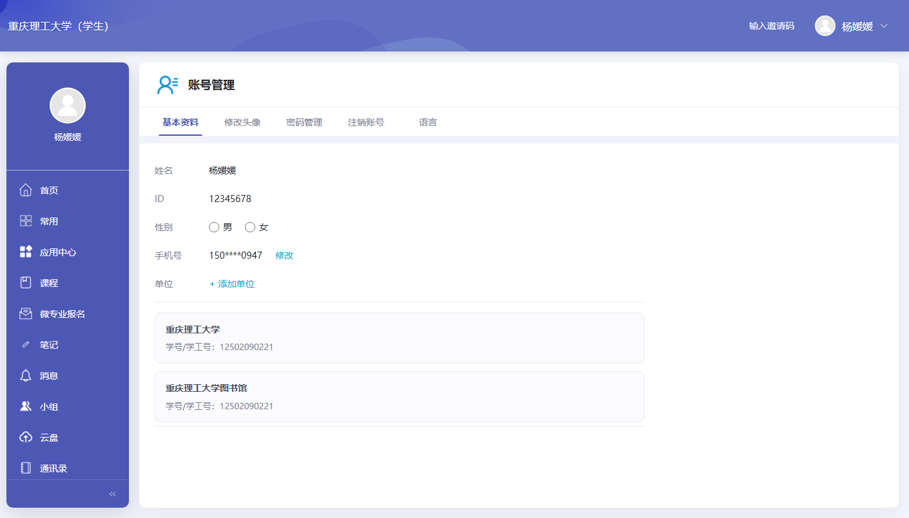
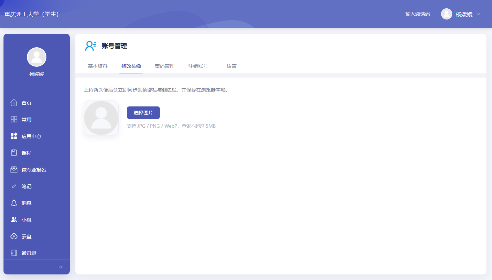
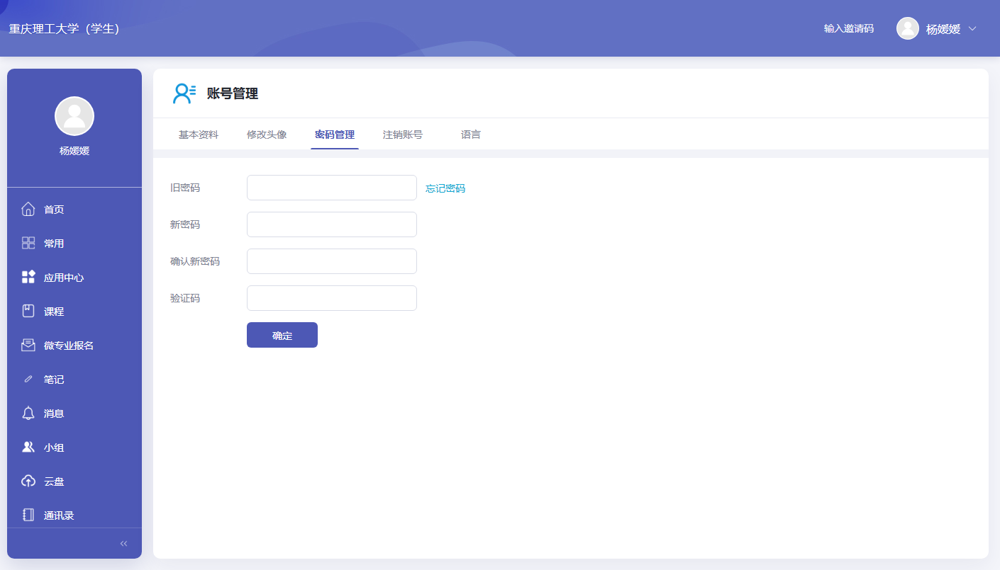
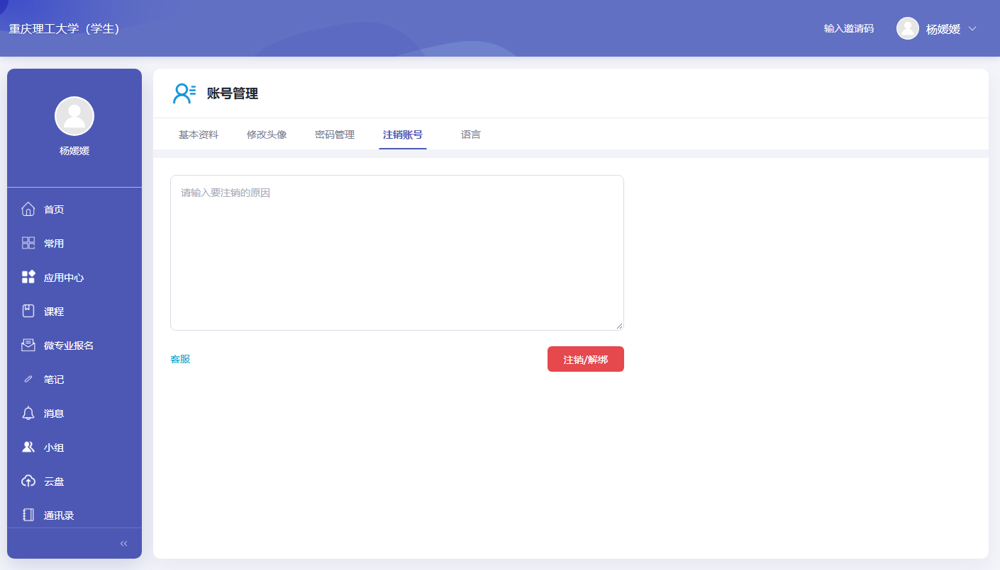
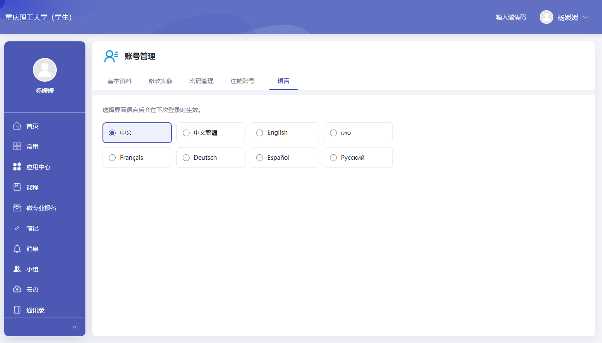
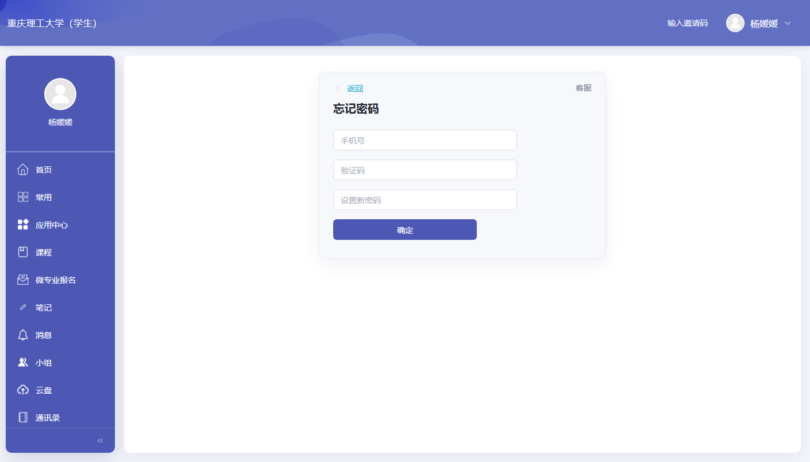
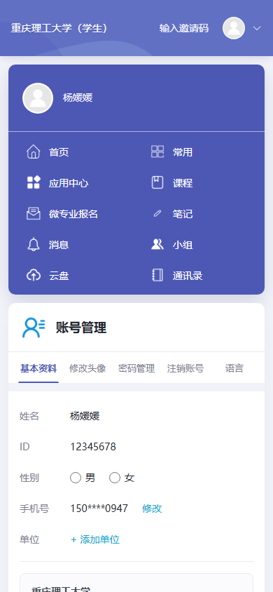

# 学习通个人中心 · Vue 3 重构版

把 `学习通页面/` 里的原生页面（`index-HTML.html` + `main.html`，通过 iframe 组合）重构为一个 Vue 3 单页应用。**原有交互、文案、数据全部保留**，视觉在保持原版布局和配色的前提下做了统一与细节打磨。



## 快速开始

环境：Node.js ≥ 20.19（推荐 22/24）、pnpm 11（推荐；10.x 需执行一次 `pnpm approve-builds` 允许 esbuild 构建脚本）。

```bash
cd xuexitong-vue
pnpm install
pnpm dev          # 开发模式，默认 http://localhost:5173
pnpm build        # 构建并生成可双击打开的单文件 dist/index.html
pnpm build:multi  # 仅常规多文件构建（部署到静态服务器时使用）
```

`pnpm build` 会把 JS、CSS、图片全部内联进 `dist/index.html`，**不需要服务器**，直接双击即可离线浏览。

> 仓库内的 `pnpm-workspace.yaml` 已按 pnpm 11 配置：`nodeLinker: hoisted`、关闭运行前的重复依赖检查，并通过 `allowBuilds` 允许 esbuild 安装脚本。

## 目录结构

```
xuexitong-vue/
├─ index.html
├─ vite.config.js               # base: './'，可部署到任意子路径
├─ pnpm-workspace.yaml          # pnpm 11 项目配置（hoisted、allowBuilds）
├─ scripts/
│  └─ inline-build.mjs          # 构建后内联资源，产出单文件
├─ docs/screenshots/            # 效果截图
└─ src/
   ├─ main.js
   ├─ App.vue                   # 整体布局 + 侧边栏/账号面板切换
   ├─ assets/images/            # 原项目图片（top-bg 由 JPEG 转为真正的 PNG）
   ├─ styles/main.css           # 设计变量、基础重置、通用表单/按钮
   ├─ data/menu.js              # 侧边栏 10 个菜单（图标 + 文案 + id）
   ├─ composables/useAvatar.js  # 头像共享状态 + localStorage 持久化
   └─ components/
      ├─ AppHeader.vue          # 顶部栏（学校、邀请码、头像入口）
      ├─ AppSidebar.vue         # 侧边栏
      ├─ ModulePlaceholder.vue  # 未接入模块的占位视图
      └─ account/
         ├─ AccountPanel.vue    # 账号管理：标题 + 5 个标签页
         ├─ BasicProfilePane.vue
         ├─ AvatarPane.vue
         ├─ PasswordPane.vue
         ├─ DeactivatePane.vue
         ├─ LanguagePane.vue
         └─ ForgotPassword.vue
```

## 原版 → Vue 对照

| 原版实现 | 重构后 |
| --- | --- |
| `index-HTML.html` + `indext.js` 直接改 `.d` / `.sidwbar-body` / `.myiframe` 的 `display` | `App.vue` 中用 `activeMenuId` 一个响应式状态描述 |
| `main.html` 通过 `<iframe>` 嵌套 | `AccountPanel.vue` 组件，随状态显隐 |
| `main.js` 里 5 个入口切换 `.zi` 的 `display` | `activeTab` + `v-show` |
| `#hidebox1` ~ `#hidebox5` 五段 HTML | 五个独立 Pane 组件 |
| `type1` ~ `type5` 五个 `div` 各绑一个 click | `tabs` 数组 + `v-for`，一个 click 处理 |
| `#que3` 点击校验两次密码 | `PasswordPane.submit()`，保留原有 `confirm` / `alert` 文案与清空逻辑 |
| `.old-s` 忘记密码：隐藏标题、标签栏、灰色分隔条，显示 `.forget` | `showForgotPassword` + `ForgotPassword.vue` |
| `.box7-f` 返回：恢复标题/标签栏并回到密码管理 | `backToPassword()`（固定回到“密码管理”） |
| `input[type=file]` + `FileReader` + `localStorage.avatarUrl` | `AvatarPane` 调用 `useAvatar().setAvatar()` |
| 上传头像后需要刷新页面才会同步 | 共享 `avatarUrl` ref，上传后顶部栏/侧边栏实时同步 |
| 侧边栏 10 个写死的 `div#s1` ~ `div#s10` | `data/menu.js` 数据驱动 |
| 满屏 `querySelector` + 事件监听 | 模板绑定、`v-model`、组件事件 |
| `chocieSidebar()` 末尾无参调用会抛 `TypeError` | 已移除该无效调用 |

## 保留的行为（与原版逐条一致）

- 默认标签页为「基本资料」，五个标签：基本资料 / 修改头像 / 密码管理 / 注销账号 / 语言。
- 两次新密码不一致：弹出 `confirm('两次输入密码不一致')`，确认后清空两个新密码框。
- 两次新密码一致：弹出 `alert('密码修改成功')`（与原版一样不清空输入）。
- 点击「注销/解绑」：弹出 `alert('确定要注销账号吗？')`，不做真实注销。
- 点击「忘记密码」：隐藏标题和标签栏，进入找回密码卡片；点击「返回」固定回到「密码管理」。
- 头像上传使用 `FileReader` 读取为 DataURL，并写入 `localStorage` 的 `avatarUrl`，刷新后保留。
- 侧边栏 10 个模块的名称、图标、顺序与原版完全一致；点击后隐藏账号面板并显示对应内容。
- 点击右上角头像，回到账号管理面板。
- 语言页 8 个选项：中文 / 中文繁體 / English / ລາວ / Français / Deutsch / Español / Русский，默认中文。

## 有意的改进

1. **设计系统**：以原版侧边栏蓝 `rgb(77, 88, 181)` 为主色，统一字体（微软雅黑）、圆角、阴影、hover / focus / active 状态。
2. **默认展示账号管理**：原版 iframe 初始是 `display:none`，右侧为空白；现在直接展示账号面板（点击侧边栏模块仍可切走，点右上角头像回来）。
3. **头像实时同步**：原版要刷新页面才能看到新头像，现在顶部栏、侧边栏、预览图共用同一份状态。
4. **上传体验**：原生文件框改为「选择图片」按钮，增加图片类型与 5MB 大小校验、读取失败提示。
5. **空状态**：未接入的模块由一行文字改为带图标、标题、说明的占位卡片。
6. **响应式**：≤900px 时侧边栏横向铺开、菜单两列；≤640px 时顶部栏精简、5 个标签等分一屏。
7. **可访问性**：可点击的 `div` 改为 `button`，表单补 `label for` / `role` / `aria-current` / `aria-selected`，键盘焦点可见。
8. **危险操作**：「注销/解绑」使用危险色，避免误触。

## 截图

| 修改头像 | 密码管理 |
| --- | --- |
|  |  |

| 注销账号 | 语言 |
| --- | --- |
|  |  |

| 忘记密码 | 移动端 |
| --- | --- |
|  |  |

## 已知限制

- 账号资料、单位信息仍是静态演示数据，与原版一致。
- 「忘记密码」页与原版一样只做界面，不提交真实请求；`alert` / `confirm` 也沿用原生弹窗。
- 头像存在 `localStorage`，超大图片可能触发浏览器配额限制（已提示，可改用对象存储）。

## 原文件

原 HTML / CSS / JS 未做任何修改，仍保留在 `学习通页面/` 目录，方便对照。
